# industrial-inspection

MVTec AD 2 기반 비지도 외관검사. "AUROC 몇 점"이 아니라 **라인에 투입할 수 있는가**를 묻습니다.

- **운영점 평가**: 미검률 예산(0%, 1%, 5%)을 고정했을 때의 과검률
- **Held-out 임계값**: `test_public`을 층화 분할해서, 한쪽에서 임계값을 정하고 다른 쪽에서 보고합니다. 분할을 반복해 분포(평균, p95)로 제시하고, 같은 세트로 보정했을 때 생기는 낙관 편향도 함께 기록합니다.
- **강건성**: 조명이나 위치가 바뀔 때의 성능 변화 (`test_public`에 섞여 있는 `regular`/`overexposed`/`underexposed`/`shift_1~4` 조건으로 분석)
- **추론 지연**: ONNX/TensorRT로 변환해 장당 지연시간 측정

## 환경

- Python 3.12, [uv](https://docs.astral.sh/uv/)
- PyTorch cu128 (RTX 50 시리즈 / Blackwell sm_120은 CUDA 12.8 이상 필요)

```
uv sync
uv run pytest
```

## 데이터

MVTec AD 2 원본: [공식 페이지](https://www.mvtec.com/research-teaching/datasets/mvtec-ad-2), CC BY-NC-SA 4.0. **2026-10 기준 MVTec의 자체 다운로드 서버(mydrive.ch)가 전체 다운로드·카테고리별 다운로드 모두 404를 반환**합니다(anomalib에 내장된 링크도 동일 증상). MVTec에 문의는 넣어뒀지만, 그동안은 비공식 미러를 씁니다.

```
uv run python scripts/prepare_ad2_mirror.py --root datasets/MVTec_AD_2
```

- 소스: [huggingface.co/datasets/pjramg/MVTecAD2_FO](https://huggingface.co/datasets/pjramg/MVTecAD2_FO) (FiftyOne export, 비공식 미러)
- `train`(2,528) / `validation`(302) / `test_public`(1,084 = good 379 + bad 705, 픽셀 단위 GT 마스크 포함) 8개 카테고리 전부 포함. **`test_private`/`test_private_mixed`는 원래도 공개된 적 없는 데이터라 어느 미러에도 없음** — 로컬 평가는 `test_public`만으로 충분합니다.
- GT 마스크는 `samples.json`에 zlib 압축된 numpy 배열(FiftyOne Segmentation 필드)로 들어 있어, 스크립트가 이를 디코딩해 anomalib이 기대하는 `ground_truth/bad/*_mask.png`로 풀어줍니다.
- 전체 약 16GB. 공식 링크가 복구되면 이 스크립트 없이 공식 아카이브를 그대로 풀어도 코드는 동일하게 동작합니다.

## 실행

```
uv run python scripts/score.py --model patchcore --category sheet_metal --root datasets/MVTec_AD_2
uv run python scripts/evaluate.py results/scores/*.csv
```

`--model`은 `patchcore`, `mhpatchcore`, `efficientad`, `dinomaly`, `dinomaly_l` 중에서 고릅니다.

## 베이스라인 실험

"AD 2에서 어떤 모델이 라인 투입 기준(미검 예산 대비 과검률)을 충족하는가"를 보기 위한 첫 비교입니다. 먼저 한 카테고리(`sheet_metal`)로 파이프라인을 검증하고, 이후 8개 카테고리로 확장합니다.

| 모델 | 계열 | anomalib 클래스 | 선정 이유 |
|---|---|---|---|
| EfficientAD | teacher-student 증류 | `EfficientAd` | AD 2 논문(IJCV 2026)의 표에서 평균 AU-PRO 58.7로 보고된 모델 |
| MH-PatchCore (Mahalanobis PatchCore) | 메모리뱅크 | `MHPatchcore` | PatchCore 계열 최신 변형. 공분산 화이트닝 + 스트리밍 coreset |
| Dinomaly (ViT-L) | DINOv2 재구성 | `Dinomaly(encoder_name="vit_large_patch14_reg4_dinov2")` | 원 논문에서 가장 강한 인코더 크기. AD 2 수치는 아직 보고된 곳을 찾지 못함 |
| PatchCore (기본) | 메모리뱅크 | `Patchcore` | 기준선 |

**학습 설정은 각 논문 값을 따릅니다.**

- EfficientAD: 70,000 iteration, 배치 1, Adam(lr 1e-4, wd 1e-5), 95% 지점(66,500)에서 lr 감소. 논문 부록 Algorithm 1과 anomalib 기본 스케줄이 일치합니다.
- Dinomaly: 카테고리별 개별 학습 5,000 iteration, 448 리사이즈 후 392 센터 크롭, StableAdamW(lr 2e-3 → 2e-4 cosine). 논문이 학습 배치 크기를 명시하지 않아서, ViT-L은 VRAM 16GB 때문에 배치 4로 실행합니다. **이 부분은 논문과 다를 수 있습니다.**
- MH-PatchCore, PatchCore: 학습 없이 특징 추출 한 번(1 epoch)으로 메모리뱅크를 만듭니다. anomalib 기본값입니다.

**평가 프로토콜**: 점수는 후처리 없이 저장하고(`score.py`), 임계값은 `test_public`을 층화 분할해 한쪽에서 정하고 다른 쪽에서 보고합니다(`evaluate.py`, 20회 반복). 미검 예산 0%, 1%, 5%일 때의 과검률과 AUROC를 비교합니다. 모든 실험은 seed 0, 단일 실행이므로 모델 간 작은 차이는 유의하지 않을 수 있습니다.

**결과** (sheet_metal, `test_public` 114장 = good 24 + defective 90, seed 0, 단일 실행)

과검률은 held-out 값입니다(`test_public`을 **부품 단위로** 층화 분할해 한쪽에서 임계값을 정하고 다른 쪽에서 측정, 20회 평균). 미검 예산 0%와 1%가 같은 것은 보정 쪽 불량이 약 45장이라 1%로는 한 장도 놓칠 수 없기 때문입니다. (2026-11-03: 처음 올린 표는 이미지 단위 분할 값이었는데 부품 단위 값으로 바꿨습니다.)

| 모델 | AUROC | 과검률 @ 미검 0% | 과검률 @ 미검 1% | 과검률 @ 미검 5% | 학습 시간 |
|---|---|---|---|---|---|
| Dinomaly (ViT-L) | **0.840** | 0.82 | 0.82 | 0.74 | 3,911 s * |
| PatchCore (기본) | 0.739 | 0.81 | 0.81 | 0.70 | 약 90 s |
| MH-PatchCore | 0.629 | 0.95 | 0.95 | 0.86 | 91 s |
| EfficientAD | 0.573 | 1.00 | 1.00 | 0.97 | 5,621 s * |

\* EfficientAD와 Dinomaly-L은 같은 GPU에서 동시에 학습했습니다. 서로 속도를 늦췄으므로 학습 시간끼리 비교할 수 없습니다(단독 실행 시 EfficientAD는 약 19 it/s, Dinomaly-L은 약 2.15 it/s).

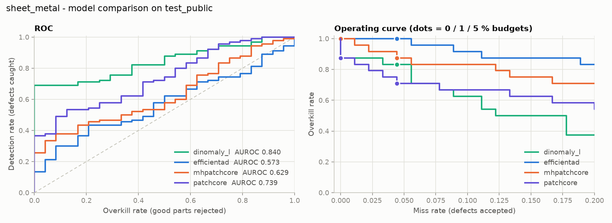

모델별 학습 곡선과 test 그래프는 [docs/figures/](docs/figures/)에 있습니다.

**읽는 법과 한계**

- **라인 투입 기준으로는 어느 모델도 부족합니다.** 가장 좋은 Dinomaly-L도 불량을 놓치지 않으려면 정상의 약 88%를 불량으로 판정해야 합니다. AUROC 순위와 과검률 순위는 거의 같지만, 격차의 크기는 AUROC만으로는 드러나지 않습니다.
- **EfficientAD는 학습할수록 test AUROC가 떨어졌습니다**(7,000 스텝 0.687 → 70,000 스텝 0.574, loss는 계속 감소). 원인은 확인하지 못했습니다. 가능한 가설은 AD 2의 조명 시프트가 섞인 test에 비해 정상 학습 분포가 좁아서 과적합되는 것이지만, 이 실험으로는 검증하지 않았습니다. 논문 설정(70,000 스텝)을 그대로 따른 결과입니다.
- **MH-PatchCore는 기본 PatchCore보다 낮았습니다.** 이 카테고리 한 곳의 단일 실행 결과이므로 일반화하지 마세요. 8개 카테고리 전체 스윕에서 다시 봐야 합니다.
- 학습 중 test AUROC 곡선은 그래프용이며 모델이나 임계값 선택에 쓰지 않았습니다.
- 표본이 작습니다(good 24장). 모델 간 작은 차이는 우연일 수 있습니다.

## 촬영 조건별 분석 (sheet_metal)

`test_public` 파일명의 조건 태그(`regular`, `overexposed`, `underexposed`, `shift_1~3`; 이 카테고리에는 `shift_4`가 없음)별로 나눠 봅니다. 조건마다 정상 4장, 불량 15장이라 **표본이 매우 작습니다**: 과검률의 해상도가 25%이고 AUROC도 대략적인 경향만 보여줍니다.

임계값은 **`regular` 이미지에서만** 미검 0%로 정하고, 나머지 조건에 그대로 적용합니다(`scripts/tag_analysis.py`). 현장에서 정상 조명에서 한 번 보정한 뒤 조건이 바뀌는 상황입니다. 평가한 조건은 보정 이미지와 겹치지 않습니다.

| 모델 | 조건별 AUROC 범위 | 정상 점수 변동 (regular 대비) | 과검률: regular → shift_1~3 |
|---|---|---|---|
| Dinomaly (ViT-L) | 0.82 ~ 0.88 | 0.99 ~ 1.23배 | 0.75 → 1.00 |
| PatchCore (기본) | 0.80 ~ 0.85 | 1.01 ~ 1.13배 | 0.50 → 1.00 |
| MH-PatchCore | 0.57 ~ 0.73 | 0.97 ~ 1.14배 | 1.00 → 1.00 |
| EfficientAD | 0.35 ~ 0.85 | 0.56 ~ 4.52배 | 1.00 → 1.00 |

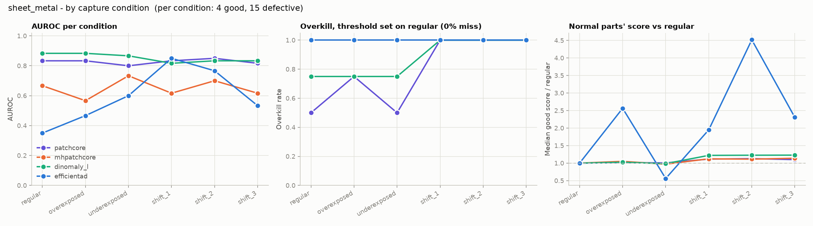

- **`shift_*` 조건에서 임계값이 깨집니다.** Dinomaly-L과 PatchCore는 정상 점수가 10~23%만 올라도 정상 4장이 모두 불량 판정(과검률 100%)이 됩니다. 정상과 불량 점수의 간격이 얇기 때문입니다. 미검은 거의 늘지 않아서, 깨지는 쪽은 놓침이 아니라 과검입니다.
- **EfficientAD는 점수 자체가 조건에 따라 크게 움직입니다.** 정상 점수가 overexposed에서 2.6배, underexposed에서 0.56배, shift_2에서 4.5배가 됩니다. 한 조건에서 정한 임계값을 다른 조건에 쓸 수 없는 수준입니다. 한 조건 안에서 보더라도 AUROC가 0.35(`regular`, 우연보다 낮음)에서 0.85까지 흔들립니다. 전체 AUROC 0.573의 낮은 값이 이 불안정성과 관련이 있어 보이지만, 인과는 확인하지 않았습니다.
- 한계: 한 카테고리, 단일 실행, 조건당 정상 4장입니다. `shift_1~3`이 정확히 어떤 변화인지는 확인하지 않았으며, 위 "shift"는 파일명 그대로의 이름입니다. 8개 카테고리 전체에서 같은 경향인지 봐야 합니다.

## 8개 카테고리 결과 (2026-10-30, RTX 5060 Ti)

PatchCore, MH-PatchCore, Dinomaly-L, EfficientAD를 8개 카테고리 전부에서 돌렸습니다(seed 0, 단일 실행). Dinomaly-L은 `--game-mode`(GPU 약 60%)로 카테고리당 약 49~53분, EfficientAD는 2026-11-03에 두 줄 병렬로 카테고리당 약 98~102분 걸렸습니다.

| 카테고리 | 결함 크기 (256px 기준) | PatchCore | MH-PatchCore | Dinomaly-L | EfficientAD |
|---|---|---|---|---|---|
| can | 1.9px | 0.460 | 0.502 | 0.503 | 0.494 |
| fabric | 2.8px | **0.716** | 0.440 | 0.698 | 0.547 |
| wallplugs | 5.0px | 0.532 | **0.537** | 0.457 | 0.534 |
| rice | 8.6px | 0.526 | 0.560 | **0.769** | 0.504 |
| sheet_metal | 12.7px | 0.739 | 0.629 | **0.840** | 0.573 |
| fruit_jelly | 16.1px | 0.759 | **0.912** | 0.870 | 0.873 |
| vial | 26.5px | 0.859 | **0.897** | 0.810 | 0.804 |
| walnuts | 28.3px | 0.840 | **0.852** | 0.715 | 0.760 |
| **평균 AUROC** | | 0.679 | 0.666 | **0.708** | 0.636 |
| 평균 과검률 @ 미검 0% (부품 단위 분할) | | 0.85 | **0.80** | 0.80 | 0.90 |
| 같은 조건에서 처음 보는 부품의 미검률 (목표 0%) | | 6.9% | 4.0% | 5.4% | **2.4%** |
| 평균 과검률 @ 미검 5% (부품 단위 분할) | | 0.81 | 0.75 | **0.74** | 0.84 |

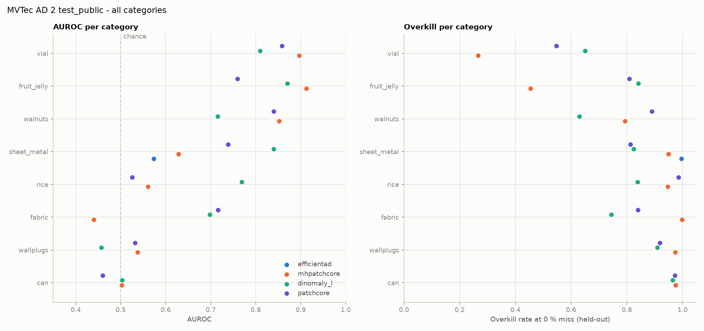

- **어느 모델도 라인 투입 기준에 못 미칩니다.** 미검 0%에서 평균 과검률이 0.80~0.85입니다. 가장 좋은 조합(vial + MH-PatchCore)도 정상의 17%를 불량으로 판정합니다.
- **모든 카테고리에서 이기는 모델은 없습니다.** 평균 AUROC는 Dinomaly-L이 가장 높지만(0.708), 카테고리별 1위는 MH-PatchCore 3개(fruit_jelly, vial, walnuts), Dinomaly-L 2개(rice, sheet_metal), PatchCore 1개(fabric)이고, can과 wallplugs는 셋 다 우연 수준이라 1위를 가릴 수 없습니다.
- **결함이 작은 카테고리는 모델과 상관없이 우연 수준입니다.** can(1.9px)과 wallplugs(5.0px)는 세 모델 모두 AUROC 0.46~0.54입니다. 결함 크기와 AUROC의 순위 상관은 PatchCore 계열에서 ρ=0.88(p=0.004)입니다(`scripts/data_profile.py`).
- **Dinomaly-L은 rice에서 PatchCore 계열보다 0.2 이상 높습니다**(0.769 vs 0.53~0.56). 입력 해상도(392 vs 224)가 커서 같은 결함이 더 크게 보이는 것이 이유일 수 있지만 검증하지 않았습니다.
- **Dinomaly-L은 학습할수록 test AUROC가 떨어지는 카테고리가 있습니다.** vial은 500 스텝 0.877에서 최종 0.810, walnuts는 0.783에서 0.715입니다. EfficientAD가 sheet_metal에서 보인 양상과 비슷합니다.

### 촬영 조건별로 보면

임계값을 `regular` 이미지로만 정하고 다른 조건에 그대로 적용했습니다(`scripts/tag_analysis.py`, 그래프는 `docs/figures/tags__<카테고리>.png`).

- **조건이 바뀌면 깨지는 쪽은 과검입니다.** 24개 (모델, 카테고리) 조합 중 11개에서 `shift_*` 조건의 과검률이 `regular`보다 올라갔고, 9개는 `regular`에서 이미 0.95 이상입니다. 반면 `shift_*`에서 미검률은 평균 1.6%로 거의 늘지 않습니다.
- **Dinomaly-L은 보통 조명에서 가장 강하지만 `shift` 조건에 가장 민감합니다.** walnuts는 `regular`에서 AUROC 0.95인데 `shift_1`, `shift_3`에서 0.46, 0.50이고 정상 점수가 최대 2.8배로 뜁니다. wallplugs도 정상 점수가 최대 2.4배까지 움직입니다. PatchCore 계열은 정상 점수 변동이 대부분 30% 이내입니다.
- 평균 AUROC는 `regular` 0.72에서 `shift_*` 0.70으로 크게 떨어지지 않지만, 고정 임계값으로 보면 과검이 크게 늘어납니다. 순위는 유지돼도 점수의 절대 위치가 움직이기 때문입니다.

### 해석할 때 주의할 점

- **분할 방식을 고쳤습니다(2026-11-02).** test의 불량 이미지는 실제로는 카테고리당 불량 부품 15개를 조건만 바꿔 찍은 것이고, 정상도 부품 4~12개입니다. 이전 `evaluate.py`는 이미지 단위로 반을 나눠 같은 부품이 임계값을 정하는 쪽과 평가하는 쪽에 함께 들어갔습니다. 이제 부품 단위로 나눕니다(`--split-unit image`로 이전 방식 재현 가능). 위 표의 과검률은 모두 부품 단위 값입니다.
- seed 0 단일 실행이고 독립 표본이 적어서, 모델 간 0.05 정도의 차이는 우연일 수 있습니다.
- sheet_metal을 다른 머신(RTX 3050, cu126)에서 다시 돌리면 AUROC가 최대 약 0.03 달라졌습니다(PatchCore 0.712 vs 0.739). 머신 간 차이도 이 정도는 있습니다.

## 추가 실험 (2026-11-02)

### 부품 단위 분할이 바꾼 것

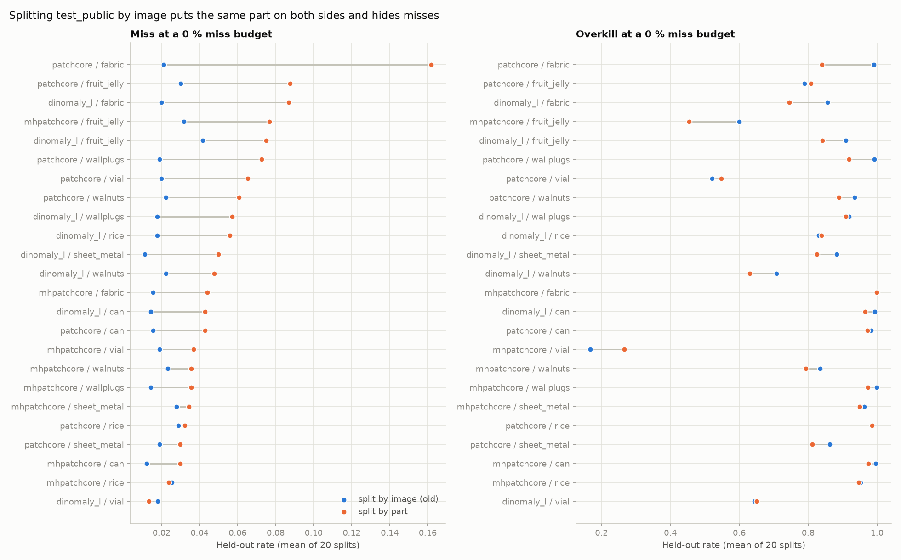

- 임계값을 미검 0%로 맞춰도 처음 보는 부품에서는 평균 **5.3%(나쁠 때 p95 17%)**를 놓칩니다. 이미지 단위로 나눴을 때는 2.1%(p95 7%)로 보였으니, 미검 위험을 약 2.5배 작게 보여줬던 셈입니다. 과검률은 평균 0.85에서 0.82로 조금 내려갔습니다.
- 가장 크게 달라진 곳은 fabric(PatchCore 미검 2.1% → 16.2%)과 fruit_jelly입니다.

### 불량 부품이 몇 개뿐일 때 임계값은 어떻게 정하나 (`scripts/few_shot_calibration.py`)

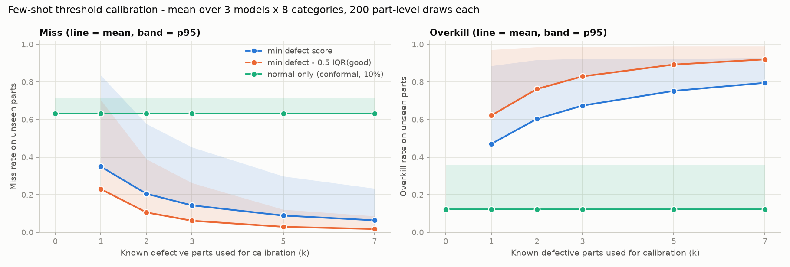

알고 있는 불량 부품 k개와 정상 부품 절반으로 임계값을 정하고, 쓰지 않은 부품에서 측정했습니다(4개 모델 × 8개 카테고리, 부품 단위 200회 반복의 평균).

| 규칙 | k | 미검률 | 과검률 |
|---|---|---|---|
| 불량 최저 점수 | 1 | 32% | 51% |
| 불량 최저 점수 | 7 | 5.6% | 82% |
| 불량 최저 점수 − 0.5×IQR(정상) | 7 | 1.5% | 94% |
| 정상만 사용 (conformal, 과검 10% 목표) | 0 | 67% | 12% |

- 불량 부품이 1개면 처음 보는 불량의 32%를 놓치고, 7개여도 5.6%를 놓칩니다. 이 데이터에서 "몇 개면 충분하다"는 수준은 없습니다.
- 마진을 주면 미검은 1.5%까지 내려가지만 과검이 94%로 올라, 사실상 전수 재검사입니다.
- 정상만으로 정하면 과검은 12%로 낮지만 불량의 67%를 놓칩니다. 이 모델들의 점수는 정상 분포의 꼬리와 불량 분포가 겹쳐서, 어떤 규칙도 미검과 과검을 동시에 낮추지 못합니다.

### 조명 조건을 알면 임계값이 나아지나 (`scripts/condition_thresholds.py`)

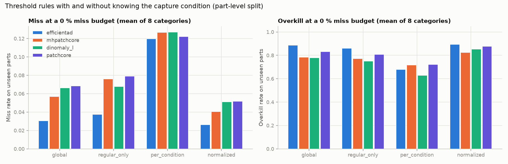

| 규칙 | 미검률 | 과검률 |
|---|---|---|
| 전체 하나 | 5.6% | 0.82 |
| `regular`만 | 6.5% | 0.80 |
| 조건별 임계값 | 12.4% | **0.69** |
| 조건별 표준화 후 하나 | 4.2% | 0.86 |

- 조건별로 임계값을 따로 정하면 과검은 줄지만 미검이 두 배가 됩니다. 조건마다 정한 불량 최저 점수가 표본 몇 개에 흔들리기 때문입니다. 조건을 알아도 둘을 동시에 낮추지는 못했습니다.

### can, wallplugs를 타일로 나눠 결함을 키우면 (`scripts/make_tiles.py`)

| 카테고리 | 기존 AUROC | 타일 AUROC | 결함 타일 비율 | 타일 단위 AUROC |
|---|---|---|---|---|
| can (8조각) | 0.502 | 0.504 | 17% | 0.558 |
| wallplugs (9조각) | 0.537 | 0.538 | 18% | 0.612 |

- 결함이 타일에서 차지하는 비율은 can 5배, wallplugs 7배 커졌지만 AUROC는 변하지 않았습니다. "결함이 해상도에서 사라진다"는 설명은 결함 크기와 AUROC의 상관(ρ=0.88)에서 나왔는데, 직접 실험에서는 확인되지 않았습니다. 결함이 든 타일 자체도 정상 타일과 잘 구분되지 않습니다(타일 AUROC 0.56~0.61). **결함 크기는 카테고리 난이도와 같이 움직이지만 원인이라고 말할 수 있는 증거는 없습니다.**

### 학습에 조명 변화를 넣으면 (`patchcore_aug`, 밝기·대비 ±35%)

평균 AUROC가 0.679에서 0.673으로 변하지 않았습니다(8개 중 4개 상승, 4개 하락, wallplugs −0.047).

### 추론 지연시간 (`scripts/latency.py`, 배치 1, RTX 5060 Ti, 전처리 포함)

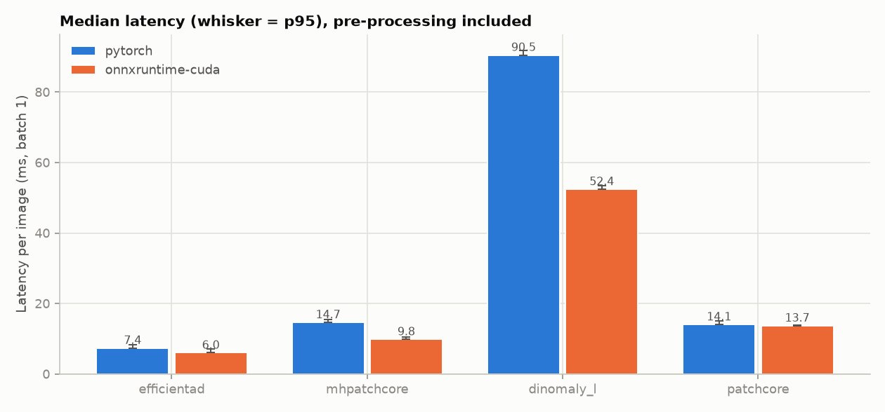

| 모델 | PyTorch | ONNX Runtime (CUDA) |
|---|---|---|
| EfficientAD | 7.4ms | 6.0ms |
| MH-PatchCore | 14.7ms | 9.8ms (※) |
| PatchCore | 14.1ms | 13.7ms |
| Dinomaly-L | 90.5ms | 52.4ms |

※ MH-PatchCore는 ONNX 점수가 PyTorch와 1.88 달라서 변환 검증이 필요합니다. 나머지는 일치합니다. 다른 작업이 GPU를 쓰는 동안 측정하면 수치가 흔들립니다. TensorRT는 측정하지 않았습니다.

## 파이프라인 검증과 이상 맵 분석 (2026-11-03)

### 원본 MVTec AD로 파이프라인 검증

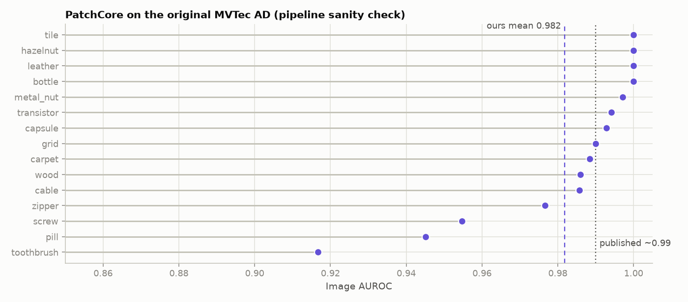

- 공식 서버는 404라서 Hugging Face의 원본 아카이브(`ProgrammerGnome/MVTecAD`)를 받았고, anomalib에 들어 있는 **공식 아카이브 SHA-256과 일치**하는 것을 확인했습니다.
- 같은 `score.py`(`--dataset mvtecad`)로 PatchCore를 15개 카테고리에 돌린 결과 평균 이미지 AUROC **0.982**입니다. 논문 평균(약 0.99)보다 약 0.01 낮지만 같은 수준이고, 11개 카테고리가 0.985 이상입니다. 낮은 곳은 toothbrush 0.917(test 42장), pill 0.945, screw 0.955입니다.
- **결론: 파이프라인은 정상입니다.** MVTec AD 2에서 우연 수준(0.5)이 나오는 카테고리는 파이프라인 오류가 아니라 데이터셋의 어려움으로 봅니다.

### 이상 맵에서 이미지 점수를 만드는 방식, 결함 위치 찾기 (`scripts/export_maps.py`)

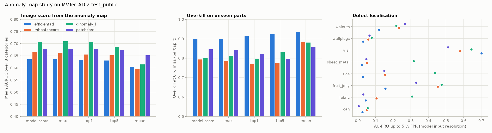

저장된 체크포인트로 재학습 없이 test를 다시 예측해 이상 맵을 저장했습니다(4개 모델 × 8개 카테고리).

- **재현**: 다시 예측한 점수의 AUROC가 26/32에서 기존 점수와 정확히 같고, 나머지 6개도 차이가 0.0006 이하입니다(GPU 부동소수점 연산 차이 수준).
- **집계 방식**: 맵의 최댓값, 상위 1% 평균, 상위 5% 평균, 전체 평균 중 **일관되게 나은 방식은 없습니다.** 평균 AUROC는 모델 자체 점수와 비슷하거나 낮고(전체 평균은 모든 모델에서 가장 나쁨), 32개 중 가장 좋은 방식도 제각각입니다. 과검률(부품 단위 분할, 미검 0%)에서는 PatchCore의 상위 5% 평균이 0.847 → 0.799로 미검(6.9% → 6.0%)과 함께 줄어든 것이 유일하게 둘 다 나아진 경우입니다. 단일 실행이라 이것만으로 방식을 바꾸지는 않았습니다.
- **결함 위치 찾기 (AU-PRO@0.05)**: 평균 Dinomaly-L 0.317, MH-PatchCore 0.211, PatchCore 0.176, EfficientAD 0.141입니다. Dinomaly-L은 rice(0.44), sheet_metal(0.32), fabric(0.31)에서 다른 모델(0.02~0.15)보다 결함 위치를 훨씬 잘 찾고, 이 세 카테고리는 Dinomaly-L의 이미지 AUROC가 높은 곳과 겹칩니다. can과 wallplugs는 네 모델 모두 0.01~0.08로, 결함 위치를 거의 찾지 못합니다. 이미지 AUROC가 우연 수준인 것과 일관됩니다.
- 이 AU-PRO는 모델 입력 해상도(리사이즈 후, MH-PatchCore와 Dinomaly는 중앙 크롭까지 한 뒤, 최대 256)에서 계산한 값입니다. 크롭하는 두 모델은 잘린 가장자리의 결함이 평가에서 빠집니다. 그래서 공식 서버의 전체 해상도 평가와는 다릅니다.

### 기타

- **조명 증강 PatchCore의 `shift` 조건**: `regular`로 정한 임계값을 `shift_*`에 적용했을 때의 과검률이 0.909 → 0.908, 정상 점수 변동이 0.111 → 0.109로, 증강의 목적이었던 조명 변화 대응에도 효과가 없었습니다.
- **EfficientAD 두 줄 병렬 실행**: 배치 1이라 GPU를 다 못 채워서, 두 카테고리를 동시에 돌리면 합계 23.7 it/s로 한 줄(약 19 it/s)보다 25% 빨랐습니다.

## 재현 단계 보완 실험 (2026-11-03, `scripts/fix_report.py`)

재현 결과를 검토하면서 나온 문제점을 확인한 실험입니다. 이것으로 재현 단계를 마치고 연구 단계로 넘어갑니다.

### MH-PatchCore도 원본 MVTec AD에서 정상인가

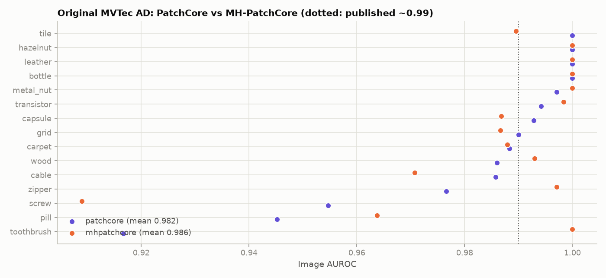

원본 MVTec AD 15개 카테고리에서 MH-PatchCore 평균 이미지 AUROC **0.986**, PatchCore **0.982**입니다. 둘 다 논문 수준(약 0.99)이므로 구현은 정상이고, AD 2에서 MH-PatchCore가 PatchCore보다 낮은 것은 구현 문제가 아닙니다.

### 해상도가 Dinomaly-L의 우위를 설명하나

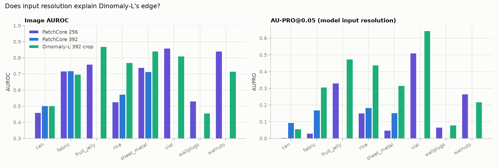

PatchCore를 Dinomaly-L과 같은 392px로 다시 학습했습니다(coreset 선택이 카테고리당 약 17분이라 4개 카테고리만).

| 카테고리 | AUROC 256 / 392 / Dinomaly-L | AU-PRO@0.05 256 / 392 / Dinomaly-L |
|---|---|---|
| can | 0.460 / 0.503 / 0.503 | 0.005 / 0.094 / 0.057 |
| fabric | 0.716 / 0.719 / 0.698 | 0.031 / 0.169 / 0.307 |
| rice | 0.526 / 0.573 / 0.769 | 0.151 / 0.184 / 0.439 |
| sheet_metal | 0.739 / 0.713 / 0.840 | 0.048 / 0.152 / 0.317 |

- 해상도를 올리면 PatchCore의 **결함 위치 찾기(AU-PRO)는 모든 카테고리에서 좋아지지만**(평균 0.059 → 0.150), 이미지 AUROC는 거의 그대로입니다(+0.017).
- rice와 sheet_metal에서 Dinomaly-L의 AUROC 우위(+0.20, +0.13)는 392px PatchCore와 비교해도 남습니다. **Dinomaly-L의 우위는 주로 해상도가 아니라 모델 자체에서 옵니다.** 결함 위치 찾기에서는 해상도가 차이의 일부를 설명합니다.

### 정상 이미지만으로 정한 임계값 (validation 정상 이미지 사용)

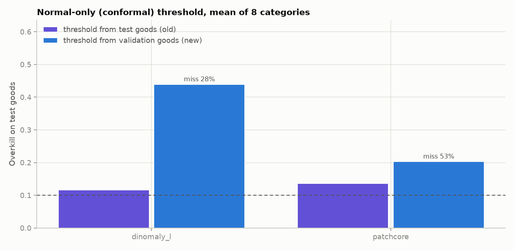

이전에는 "정상만 사용" 규칙의 임계값을 test 정상 이미지로 정해서, 평가에 쓰는 이미지로 임계값을 정하는 문제가 있었습니다. 이번에는 학습에 쓰지 않은 `validation` 정상 이미지(카테고리당 19~48장)로 과검 10% 목표 임계값을 정하고 test에 적용했습니다.

| 모델 | 과검률 (전체) | 과검률 (regular 조명만) | 과검률 (shift 조명) | 미검률 |
|---|---|---|---|---|
| PatchCore | 20% | 7% | 31% | 53% |
| Dinomaly-L | 44% | 11% | 66% | 28% |

- 보통 조명(regular)에서는 목표 10% 근처가 지켜집니다. validation 정상 이미지가 모두 보통 조명이기 때문입니다.
- 조명이 바뀐 test 이미지에서 과검이 크게 늘어납니다. **정상 이미지만으로 정한 임계값은 조명 변화에 깨지고**, 이것이 연구 질문 Q2의 출발점입니다.

### 부품 단위 부트스트랩 신뢰구간 (`scripts/bootstrap_ci.py`)

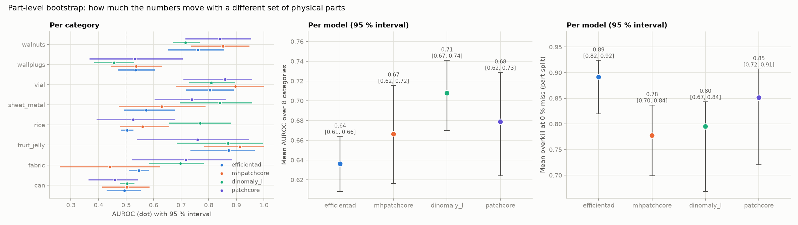

카테고리마다 실제 부품을 복원 추출해 300번 다시 계산했습니다(재학습 없음).

- 카테고리별 AUROC 95% 구간 폭의 중앙값은 0.21, 과검률은 0.31입니다. 32개 중 14개의 AUROC 구간이 0.5를 포함합니다.
- 모델 평균 AUROC: Dinomaly-L 0.71 [0.67, 0.74], PatchCore 0.68 [0.62, 0.73], MH-PatchCore 0.67 [0.62, 0.72], EfficientAD 0.64 [0.61, 0.66]. 구간이 겹치므로 **Dinomaly-L이 EfficientAD보다 낫다는 것 외에는 모델 순위를 확정할 수 없습니다.**

### 이미지 읽기 시간 (`scripts/io_latency.py`)

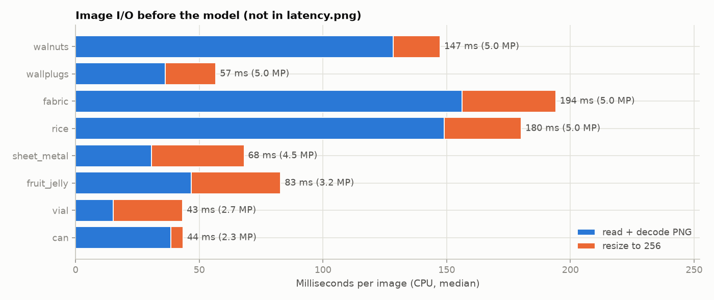

카메라 해상도 PNG(2.3~5.0 MP)를 읽고 256px로 줄이는 데 CPU에서 이미지당 43~194ms가 걸립니다. 모델 추론(6~52ms)보다 길 수 있어서, 실제 라인에서는 카메라 원본 처리 경로를 따로 최적화해야 합니다.

### 하지 않기로 한 것

- **타일 재실험(메모리 뱅크 9000)**: 이전 타일 실험은 메모리 뱅크 크기가 고정(1000)된 혼선이 있었습니다. 그러나 MH-PatchCore를 연구 모델에서 제외하면서 재실험을 취소했고, 작은 결함 질문(Q1)에서 PatchCore로 다시 설계합니다.
- **seed 반복**: 하지 않습니다. 대신 위의 부품 단위 부트스트랩으로 불확실성을 보입니다.

## 연구 단계 (2026-11-03~)

연구 모델은 **PatchCore**(방법 개발용, 빠름)와 **Dinomaly-L**(최종 확인용, 가장 높은 성능)만 씁니다. EfficientAD는 4개 카테고리가 우연 수준이고 학습이 느려서, MH-PatchCore는 PatchCore와 결과가 비슷하고 ONNX 변환이 맞지 않아서 제외했습니다.

- **Q2 (주 질문)**: 학습은 보통 조명뿐인데, 조명이 바뀌면 생기는 과검을 줄일 수 있나. walnuts에서 시작해 vial, sheet_metal에서 확인합니다.
- **Q1**: 아주 작은 결함을 잡을 수 있나. can에서 시작해 wallplugs에서 확인합니다.
- 규칙: 카테고리마다 실제 부품을 개발용 절반과 평가용 절반으로 한 번 나누고, 방법 비교는 개발용에서만 합니다. 평가용은 최종 보고에 한 번만 씁니다.

### Q2-1: 이상 맵을 이미지 자신의 기준으로 정규화 (`scripts/q2_selfnorm.py`, walnuts 개발용 절반)

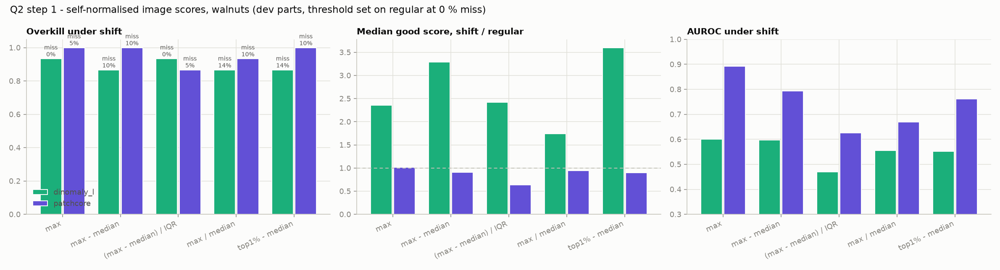

가설: 조명이 바뀌면 맵 전체가 올라가므로, 맵의 중앙값을 빼거나 나누면 조명 효과가 상쇄된다. regular에서 미검 0% 임계값을 정하고 shift 조건에 그대로 적용했습니다.

| 모델 | 점수 | shift 과검률 | shift 미검률 | 정상 점수 변동 (1 = 없음) |
|---|---|---|---|---|
| PatchCore | 최댓값 | 1.00 | 4.8% | 1.01 |
| PatchCore | (최댓값 − 중앙값) / IQR | 0.87 | 4.8% | 0.64 |
| Dinomaly-L | 최댓값 | 0.93 | 0% | 2.36 |
| Dinomaly-L | 최댓값 − 중앙값 | 0.87 | 9.5% | 3.29 |

**가설은 기각됐습니다.** 중앙값을 빼도 Dinomaly-L의 변동은 오히려 커집니다. 조명 효과는 맵 전체를 올리는 것이 아니라 그림자와 반사처럼 **국소적**입니다. 다음은 입력 이미지 정규화(CLAHE 등)와 국소 조명 증강입니다.

### Q2 다음 단계 코드 (준비 완료, 아직 실행 전)

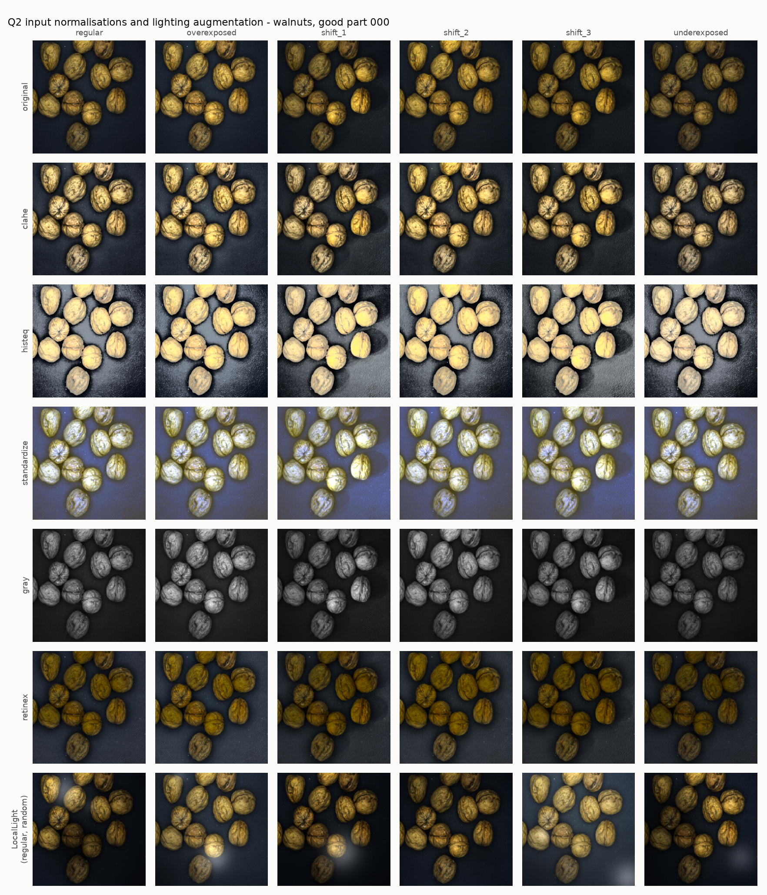

- `src/industrial_inspection/lighting.py`: 입력 정규화 `LightNorm`(clahe, histeq, standardize, gray, retinex)과 국소 조명 증강 `LocalLight`(방향성 밝기 기울기, 부드러운 그림자, 반사광, 감마).
- `score.py` 모델 이름: `<base>_<norm>`(정규화), `<base>_light`(증강), `<base>_light_<norm>`(둘 다). base는 `patchcore` 또는 `dinomaly_l`이고, 나머지 설정은 base와 같습니다. 정규화는 크기 조정 뒤, ImageNet 정규화 앞에서 학습과 test 모두에 적용됩니다.
- `scripts/q2_preview.py`: 학습 전에 같은 정상 부품이 조건별로 어떻게 바뀌는지 보는 그림(위). walnuts의 `shift` 조건은 조명 방향이 바뀌어 그림자 방향이 달라집니다.
- `scripts/q2_compare.py`: 개발용 절반에서 변형들을 비교하고, 부품 단위 부트스트랩 95% 구간과 base 모델 대비 짝지은 차이를 냅니다.
- `scripts/q2_run.sh`: 모든 변형을 먼저 스모크 테스트하고, 하나라도 실패하면 본 실행을 시작하지 않습니다.

### Q2-2: 입력 정규화 (H2-b, PatchCore, walnuts 개발용 절반, 2026-11-05)

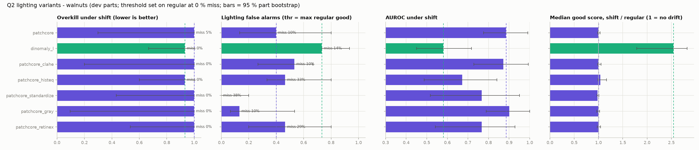

| 변형 | shift 과검률 (미검 0%) | 조명 오경보 | 조명 오경보 변화 (95% 구간) | 조명 바뀐 불량 놓침 | shift AUROC |
|---|---|---|---|---|---|
| PatchCore (기준) | 1.00 | 0.40 | | 10% | 0.89 |
| + CLAHE | 1.00 | 0.53 | +0.13 [−0.27, +0.40] | 10% | 0.87 |
| + 히스토그램 평활화 | 0.93 | 0.47 | +0.07 [−0.33, +0.33] | 33% | 0.67 |
| + 표준화 | 1.00 | **0.00** | **−0.40 [−0.80, −0.10]** | 38% | 0.77 |
| + 흑백 | 1.00 | **0.13** | −0.27 [−0.53, 0.00] | 10% | 0.90 |
| + Retinex | 1.00 | 0.47 | +0.07 [−0.40, +0.24] | 29% | 0.77 |

- **원래 정한 주 지표로는 판단할 수 없습니다.** 개발용 절반의 보통 조명 불량은 7장뿐이라, 불량을 하나도 놓치지 않는 임계값은 PatchCore에서 보통 조명의 정상 5장까지 모두 걸러냅니다(과검 1.00). 조명이 바뀌기 전부터 끝까지 차 있어서 차이를 보여줄 수 없습니다.
- 그래서 **조명 오경보** 지표를 추가했습니다(`q2.evaluate`의 `fa_shift`). 보통 조명 정상 사진 중 가장 높은 점수를 임계값으로 잡고, 조명이 바뀐 정상 사진이 그보다 높게 나오는 비율을 봅니다. 주 지표를 보고 난 뒤에 추가한 것이므로 최종 판단은 평가용 절반에서 합니다.
- **walnuts에서 PatchCore는 원래 조명에 강합니다**(정상 점수 변동 1.00, shift AUROC 0.89가 보통 조명 0.63보다 높음). 조명에 약한 것은 Dinomaly-L입니다(변동 2.55배, AUROC 0.86 → 0.58).
- **표준화**는 오경보를 0으로 줄였지만(구간이 0을 포함하지 않음) 조명 바뀐 불량을 38% 놓칩니다. 점수를 전체적으로 낮춰서 생긴 맞바꿈이라 개선이라고 보지 않습니다.
- **흑백**은 오경보를 0.40 → 0.13으로 줄이면서 놓침(10%)과 AUROC(0.90)는 그대로입니다. 구간 상한이 정확히 0이라 확실하다고는 못 하지만 가장 유력한 후보입니다. 색 변화가 조명 오경보의 일부를 만든다는 뜻일 수 있습니다.
- CLAHE, 히스토그램 평활화, Retinex는 도움이 되지 않았습니다. 미리보기에서 조건 간 차이를 가장 잘 줄여 보였던 CLAHE도 효과가 없었습니다.
- **결론: 확실한 승자는 없고, 흑백이 후보입니다.** 정상 부품이 5개뿐이라 구간이 넓습니다.

### Q2-3: 국소 조명 증강 (H2-c, PatchCore, walnuts 개발용 절반, 2026-11-05)

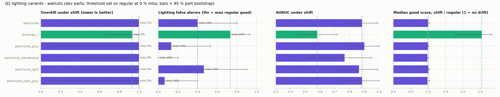

학습 사진의 절반에 방향성 밝기 기울기, 부드러운 그림자, 반사광, 감마를 무작위로 넣었습니다(`LocalLight`, p=0.5).

| 변형 | 조명 오경보 | 기준 대비 변화 (95% 구간) | 조명 바뀐 불량 놓침 | shift AUROC |
|---|---|---|---|---|
| PatchCore (기준) | 0.40 | | 10% | 0.89 |
| + 증강 | 0.47 | +0.07 [−0.20, +0.57] | 14% | 0.87 |
| + 증강 + 흑백 | 0.07 | **−0.33 [−0.67, −0.07]** | 24% | 0.89 |
| + 흑백 (H2-b) | 0.13 | −0.27 [−0.53, 0.00] | 10% | 0.90 |

- 증강만으로는 효과가 없습니다. 증강과 흑백을 함께 쓰면 오경보는 확실히 줄지만 놓침이 10% → 24%로 늘어 맞바꿈입니다.
- PatchCore에서는 **흑백 하나가 놓침 없이 오경보를 줄인 유일한 방법**입니다.
- 다만 walnuts에서 PatchCore는 원래 조명에 강해서, 조명 대책의 효과를 보여줄 여지가 작습니다. 그래서 H2-d는 조명에 약한 Dinomaly-L에 흑백과 증강을 각각 적용합니다.

### Q2-4: Dinomaly-L에 적용 (H2-d, walnuts 개발용 절반, 2026-11-05)

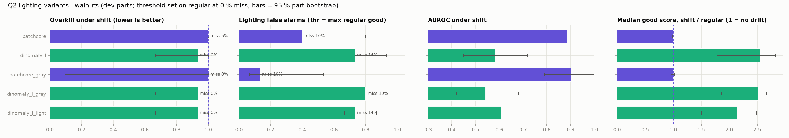

| 변형 | 조명 오경보 | 기준 대비 변화 (95% 구간) | 조명 바뀐 불량 놓침 | shift AUROC | 정상 점수 변동 | 보통 조명 AUROC |
|---|---|---|---|---|---|---|
| Dinomaly-L (기준) | 0.73 | | 14% | 0.58 | 2.55배 | 0.86 |
| + 흑백 | 0.80 | +0.07 [0.00, +0.20] | 10% | 0.54 | 2.52배 | 0.89 |
| + 국소 조명 증강 | 0.73 | 0.00 [−0.17, 0.00] | 14% | 0.61 | 2.14배 | 0.83 |

- **둘 다 Dinomaly-L의 조명 오경보를 줄이지 못했습니다.** 흑백은 효과가 없고, 증강은 정상 점수 변동을 2.55배 → 2.14배로 조금 줄였지만 오경보는 그대로입니다.
- PatchCore에서 흑백이 줄였던 오경보는 색 변화 때문이었고, Dinomaly-L이 조명에 약한 이유는 색이 아니라 그림자와 밝기의 구조 변화로 보입니다.
- 참고: test 전체 AUROC는 증강으로 0.715 → 0.771이 됐지만, 평가용 절반이 섞인 숫자라 판단에 쓰지 않습니다.

### Q2 중간 결론 (walnuts)

**입력 이미지를 바꾸는 방법(점수 정규화, 입력 정규화, 국소 조명 증강)으로는 조명 오경보를 확실히 줄이지 못했습니다.** 성공한 방법이 없으므로 평가용 절반과 vial·sheet_metal 확인은 하지 않았습니다. 확인된 것은 세 가지입니다.

1. walnuts에서 조명에 약한 것은 Dinomaly-L이고 PatchCore는 원래 강합니다(정상 점수 변동 2.55배 vs 1.00배).
2. 조명 효과는 이미지 전체가 아니라 그림자 방향 같은 국소적인 변화입니다.
3. 개발용 절반(정상 부품 5개)에서는 미검 0% 기준 지표가 이미 끝까지 차 있어서, 조명 오경보 지표가 필요했습니다.

### Q2-5: 새 조명에서 정상품 k개를 다시 찍어 맞추기 (H2-e, `scripts/q2_fewshot.py`, 2026-11-05)

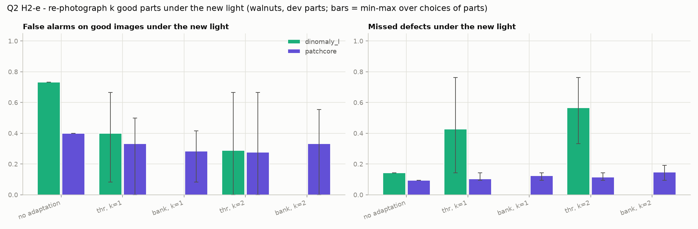

라인 상황: 조명이 `shift_*` 중 하나로 바뀐 뒤, 생산을 다시 시작하기 전에 정상 부품 k개를 새 조명에서 찍습니다(불량은 필요 없음). 재학습은 하지 않습니다.

- **thr**: 임계값을 보통 조명 정상 최고점과 새로 찍은 k장 중 높은 쪽으로 다시 맞춤
- **bank**(PatchCore만): 새로 찍은 k장의 패치 특징을 메모리 뱅크에 추가

개발용 절반에서, 조건마다 정상 부품 k개를 고르는 모든 경우(k=1: 5가지, k=2: 10가지)로 맞추고 **나머지 부품**에서 측정했습니다.

| 모델 | 방법 | 조명 오경보 (평균, 경우별 최소~최대) | 조명 바뀐 불량 놓침 |
|---|---|---|---|
| PatchCore | 맞추지 않음 | 0.40 | 9.5% |
| PatchCore | bank, k=1 | 0.28 (0.08~0.42) | 12% |
| PatchCore | thr, k=2 | 0.28 (0~0.67) | 11% |
| Dinomaly-L | 맞추지 않음 | 0.73 | 14% |
| Dinomaly-L | thr, k=1 | 0.40 (0.08~0.67) | **43%** |
| Dinomaly-L | thr, k=2 | 0.29 (0~0.67) | **57%** |

- **PatchCore**: 정상 부품 1개만 새 조명에서 찍어 메모리 뱅크에 넣어도 오경보가 0.40 → 0.28로 줄고, 놓침은 9.5% → 12%로 조금 늘었습니다. 지금까지 시험한 방법 중 가장 현실적인 개선이지만, 어느 부품을 찍느냐에 따라 0.08~0.42로 크게 흔들립니다.
- **Dinomaly-L**: 임계값을 다시 맞추면 오경보는 줄지만 불량을 43~57% 놓칩니다. 새 조명에서 Dinomaly-L의 정상 점수가 불량 점수와 겹치기 때문이라, 임계값으로는 풀 수 없습니다. 고치려면 새 조명 사진으로 모델 자체를 미세조정해야 합니다(별도 실험, 학습 필요).

### Q2-6: Dinomaly-L을 새 조명 정상품 1개로 짧게 미세조정 (H2-f, `scripts/q2_finetune.py`, 2026-11-05)

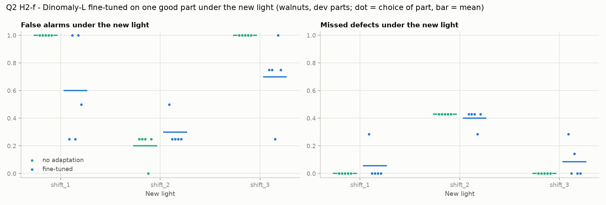

학습된 Dinomaly-L에서 시작해, 새 조명에서 찍은 정상 부품 1개의 사진과 원래 학습 사진(보통 조명)을 반씩 섞어 200스텝(약 95초) 더 학습했습니다. 인코더는 학습 때처럼 고정하고, Dinomaly의 옵티마이저(StableAdamW)를 원 학습이 끝날 때의 학습률(2e-4)로 썼습니다. 조건 3개 × 고를 수 있는 부품 5개 = 15번, 개발용 절반의 나머지 부품에서 측정했습니다.

| 새 조명 | 조명 오경보: 그대로 → 미세조정 | 놓침: 그대로 → 미세조정 |
|---|---|---|
| shift_1 | 1.00 → **0.60** (0.25~1.00) | 0% → 6% |
| shift_2 | 0.20 → 0.30 | 43% → 40% |
| shift_3 | 1.00 → **0.70** (0.25~1.00) | 0% → 9% |
| 평균 | 0.73 → 0.53 | 14% → 18% |

- 임계값만 다시 맞췄을 때(H2-e, 오경보 0.40에 놓침 43%)보다 **맞바꿈이 훨씬 좋습니다.** 정상 점수가 불량과 겹치던 문제를 모델이 일부 배웠습니다.
- shift_1, shift_3처럼 오경보가 1.00이던 조건에서 줄었고, 원래 오경보가 낮던 shift_2는 그대로입니다. 어느 부품을 고르느냐에 따라 0.25~1.00으로 흔들립니다.
- 그래도 **절대 수준은 PatchCore + 메모리 뱅크에 정상 1개 추가(H2-e, 오경보 0.28, 놓침 12%)가 가장 좋습니다.**

### Q2 결론 (walnuts 개발용 절반)

| 방법 | 재학습 | 결과 |
|---|---|---|
| 이상 맵 자기 정규화 (H2-a) | 없음 | 효과 없음 |
| 입력 정규화 5종 (H2-b) | 없음 | PatchCore 흑백만 후보, Dinomaly-L에는 효과 없음 |
| 국소 조명 증강 (H2-c, H2-d) | 학습 | 효과 없음 |
| 새 조명 정상품 1~2개로 임계값 다시 맞추기 (H2-e) | 없음 | PatchCore 약간 개선, Dinomaly-L은 놓침이 크게 늘어남 |
| **새 조명 정상품 1개를 PatchCore 메모리 뱅크에 추가 (H2-e)** | 없음 | **오경보 0.40 → 0.28, 놓침 9.5% → 12%** |
| 새 조명 정상품 1개로 Dinomaly-L 미세조정 (H2-f) | 95초 | 오경보 0.73 → 0.53, 놓침 14% → 18% |

개발용 절반에서는 **새 조명 정상품 1개를 PatchCore 메모리 뱅크에 추가**하는 방법이 가장 좋아 보였습니다. 아래에서 처음으로 평가용 절반과 다른 카테고리로 확인했습니다.

### Q2 최종 확인: 평가용 절반(walnuts)과 vial, sheet_metal (2026-11-05)

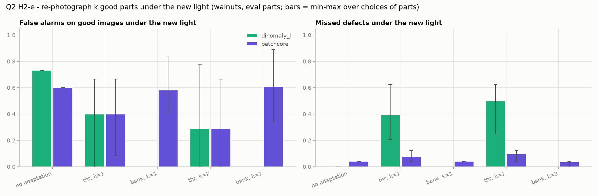

walnuts는 지금까지 한 번도 쓰지 않은 평가용 절반에서 한 번만 측정했습니다. vial(정상 부품 5개)과 sheet_metal(4개)은 방법을 고르는 데 쓴 적이 없으므로 전체 부품을 썼습니다. 재학습은 없습니다.

| 카테고리 | 모델 | 맞추지 않음 (오경보 / 놓침) | 메모리 뱅크에 1개 추가 | 임계값 다시 맞추기, 1개 |
|---|---|---|---|---|
| walnuts 평가용 | PatchCore | 0.60 / 4% | 0.58 / 4% | 0.40 / 8% |
| walnuts 평가용 | Dinomaly-L | 0.73 / 0% | | 0.40 / 39% |
| vial | PatchCore | 0.10 / 32% | 0.16 / 27% | 0.10 / 32% |
| vial | Dinomaly-L | 0.65 / 0% | | 0.36 / 6% |
| sheet_metal | PatchCore | 0.83 / 2% | 0.86 / 3% | 0.50 / 17% |
| sheet_metal | Dinomaly-L | 1.00 / 0% | | 0.50 / 17% |

- **개발용 절반의 승자(메모리 뱅크 추가)는 재현되지 않았습니다.** walnuts 평가용 절반에서 0.60 → 0.58, vial과 sheet_metal에서는 오히려 조금 나빠졌습니다. 정상 부품 5개로 고른 결과가 우연이었습니다. 평가용 절반을 따로 둔 이유가 바로 이것입니다.
- **임계값 다시 맞추기는 모든 곳에서 오경보를 줄이지만 항상 놓침을 늘립니다**(walnuts PatchCore 4 → 8%, sheet_metal 2 → 17%). 맞바꿈일 뿐 문제를 푼 것은 아닙니다. 가장 나은 경우는 vial의 Dinomaly-L(오경보 0.65 → 0.36, 놓침 0 → 6%)입니다.

### Q2 결론

**학습 없이(정규화, 점수 처리, 임계값, 메모리 뱅크 추가) 조명 변화로 인한 과검을 줄이는 방법은 찾지 못했습니다.** 효과가 보였던 것은 모두 놓침과 맞바꾼 것이거나, 개발용 절반에서만 나타난 우연이었습니다. 모델 자체가 새 조명을 배우는 Dinomaly-L 미세조정(H2-f)도 아래처럼 다른 카테고리에서 재현되지 않았습니다.

| 카테고리 | Dinomaly-L 조명 오경보: 그대로 → 미세조정 (놓침) |
|---|---|
| walnuts 개발용 절반 | 0.73 → 0.53 (14% → 18%) |
| vial (조건 4개 × 부품 5개 = 20회) | 0.65 → 0.63 (0% → 0%) |
| sheet_metal (조건 3개 × 부품 4개 = 12회) | 1.00 → 1.00 (0% → 0%) |

**정리하면, MVTec AD 2의 조명 변화로 생기는 과검은 정상품 한두 개로 하는 가벼운 대응(정규화, 증강, 임계값, 메모리 뱅크, 95초 미세조정)으로는 줄지 않습니다.** 라인에 쓰려면 새 조명의 정상품을 훨씬 많이 모아 다시 학습하거나, 조명 자체를 고정하는 공정 쪽 대책이 필요해 보입니다. 이번 실험들의 가장 큰 교훈은 정상 부품 5개짜리 개발용 절반에서 고른 방법이 쉽게 우연이 된다는 점이고, 평가용 절반과 다른 카테고리 확인이 그것을 잡아냈습니다.

## Q1: 작은 결함 (can, 2026-11-05)

### H1-a, H1-c: 해상도를 올리면, 그리고 결함 크기별로 보면 (`scripts/q1_size.py`)

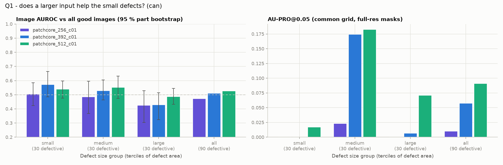

PatchCore를 256, 392, 512로 돌리되 메모리 뱅크 비율은 셋 다 1%(PatchCore 논문의 PatchCore-1% 설정)로 맞춰 해상도만 바뀌게 했습니다. 결함 위치 찾기(AU-PRO)는 세 해상도 모두 같은 512 격자에서, 원본 해상도 마스크를 max-pool로 줄여 채점했습니다(`export_maps.py --eval-side 512`). 그래야 2픽셀 결함이 채점에서 사라지지 않습니다. 결함은 면적으로 30장씩 세 그룹으로 나눴습니다(이미지의 0.001~0.02%).

| 해상도 | 이미지 AUROC | 작은 결함 | 중간 결함 | 큰 결함 | AU-PRO@0.05 | 학습(대표 패치 선택 포함) |
|---|---|---|---|---|---|---|
| 256 | 0.47 | 0.51 | 0.48 | 0.43 | 0.010 | 1.5분 |
| 392 | 0.51 | 0.57 [0.49, 0.67] | 0.53 | 0.43 | 0.058 | 3.6분 |
| 512 | 0.53 | 0.54 | 0.55 | 0.49 | 0.091 | 64분 |

- **해상도를 올리면 결함 위치 찾기는 좋아집니다**(AU-PRO 0.01 → 0.09, 중간 크기 결함 0.02 → 0.18).
- **하지만 불량 판정(이미지 AUROC)은 512에서도 우연 수준입니다.** 모든 크기 그룹의 95% 구간이 0.5를 포함하고, 작은 결함에서만 좋아지는 경향도 없습니다.

### 왜 안 되는지 직접 보기 (`scripts/q1_look.py`)

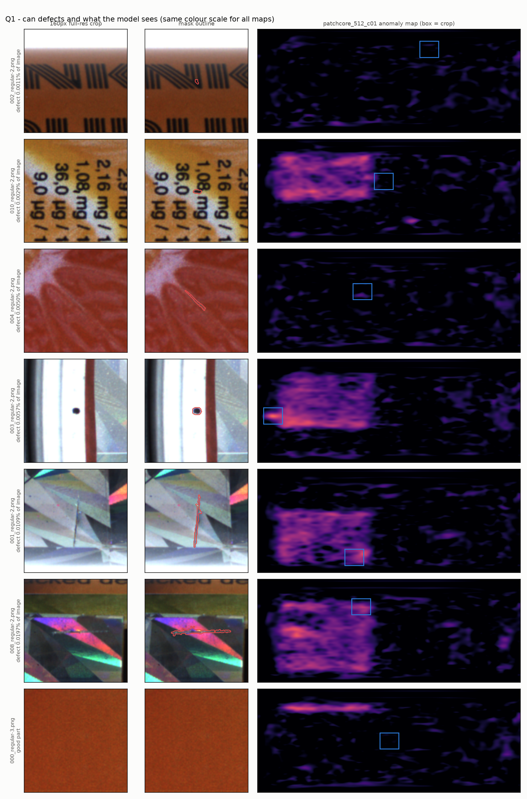

- 결함은 맵에서 **보입니다**(점 결함 003, 긁힘 008). 결함이 너무 작아 사라지는 것이 아닙니다.
- 그런데 일부 캔에서는 **홀로그램 라벨 영역 전체가 결함보다 밝게** 나옵니다. 이미지 점수(맵 최댓값)는 결함이 아니라 이 영역에서 정해집니다.
- 촬영 조건별로 봐도 보통 조명에서 AUROC 0.44이고, test 정상 캔의 점수(중앙값 41.9)가 validation 정상 캔(39.6)보다 높습니다. **처음 보는 캔이라는 것 자체**가 결함보다 더 이상하게 보입니다.

### H1-d: 위치별 정상 변동을 빼면 (`scripts/q1_locnorm.py`)

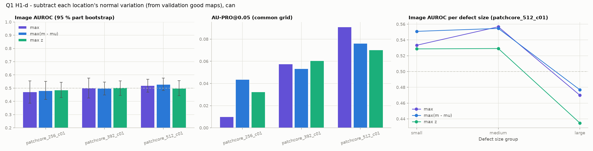

validation 정상 46장의 맵으로 위치마다 평소 수준(평균)과 흔들림(표준편차)을 구해 test 맵에서 뺐습니다(재학습 없음). 세 해상도 모두 AUROC 0.48~0.53으로 **효과가 없습니다.** 밝은 영역이 늘 같은 자리가 아니라 캔마다(라벨이 보이는 각도마다) 달라서, 위치별 평균으로는 지워지지 않습니다.

### Q1 결론

**can이 우연 수준인 이유는 "결함이 작아서"가 아니라 "캔마다 다른 정상 변화(라벨 위치, 홀로그램 반사)가 결함보다 커서"입니다.** 해상도를 올리면 결함 위치는 더 잘 찾지만, 이미지 점수를 정하는 것은 정상 변화입니다. 그래서 타일 실험(H1-b)은 하지 않았습니다. 타일도 결국 해상도를 올리는 방법이기 때문입니다. 다음 후보는 캔을 정렬하거나(회전 맞추기), 라벨 영역을 따로 다루는 것입니다.

## 알려진 함정

- **경로에 비ASCII 문자가 있으면 anomalib이 거부합니다.** 경로 검증이 절대 경로로 바꾸기 전 문자열에 대해 이뤄지므로, 데이터 경로는 레포 기준 상대 경로로 넘기세요.
- **pandas 3과 anomalib 2.7은 호환되지 않습니다.** pandas 3에서 정상 샘플의 `mask_path`가 `None` 대신 `NaN`이 되어 학습 중 TypeError가 납니다. 그래서 `pandas<3`으로 고정했습니다.
- **점수는 후처리 없이 원시값으로 저장합니다.** anomalib 기본 후처리는 min-max 정규화 후 [0, 1]로 잘라내는데, 이러면 양 끝에 동점이 생겨 임계값 위치가 가려집니다.

## 로드맵

1. [x] 평가 모듈 (운영점, held-out 분할, 층화 부트스트랩)
2. [x] 8개 카테고리 베이스라인: PatchCore, MH-PatchCore, Dinomaly-L, EfficientAD 모두 8/8 완료. 원본 MVTec AD로 파이프라인 검증(PatchCore 평균 0.982)
3. [x] 소수 불량 보정: 규칙 3가지 비교 완료(위 "추가 실험"). 어떤 규칙도 미검과 과검을 동시에 낮추지 못함
4. [~] 조명 시프트 강건성 (연구 Q2): 조건별 분석, 밝기 증강, 조건별 임계값, 맵 자기 정규화까지 효과 없음. 입력 정규화와 국소 조명 증강 진행 예정
5. [~] ONNX/TensorRT: ONNX Runtime 지연시간 측정 완료(MH-PatchCore 변환 검증 필요), TensorRT는 아직
6. [ ] (선택) VLM 기반 불량 유형 설명
